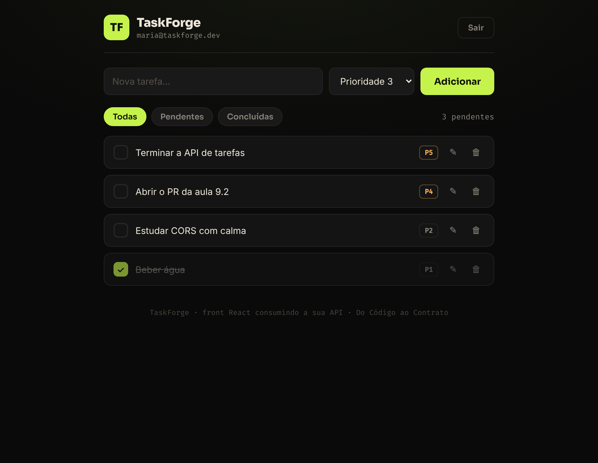

# TaskForge Web

Front-end em **React** do TaskForge, o projeto do curso [**Do Código ao Contrato**](https://docodigoaocontrato.com.br).

É um site de verdade que conversa com a **sua API** (o back-end em Spring Boot que você construiu no curso): cadastro, login com token JWT, e o CRUD de tarefas — tudo pela tela.



---

## Antes de começar

Você precisa de duas coisas:

1. **A sua API rodando** em `http://localhost:8082` (o TaskForge do curso, da aula 9.1 em diante — com o **CORS liberado pra porta `5173`**).
2. **Node.js 18 ou mais novo.** Para conferir, rode no terminal: `node --version`. Não tem? Baixe em [nodejs.org](https://nodejs.org) (versão **LTS**).

---

## Como rodar (3 passos)

No terminal, dentro desta pasta:

```bash
npm install     # 1. baixa as dependências (só na primeira vez)
npm run dev     # 2. sobe o site
```

Pronto. Ele abre sozinho em **http://localhost:5173** (passo 3 é só olhar o navegador 🙂).

Para parar, aperte `Ctrl + C` no terminal.

---

## Apontando pra sua API

O endereço da API fica em **um lugar só**: o topo do arquivo [`src/api.js`](src/api.js).

```js
export const API = "http://localhost:8082";
```

Se a sua API roda em outra porta, muda só essa linha.

---

## O "contrato": o que o front espera da sua API

O front é só mais um cliente da API (como o Insomnia ou o Swagger). Ele conta com estas rotas:

| Ação na tela        | Método e rota                   | Corpo enviado                               | Resposta esperada        |
|---------------------|---------------------------------|---------------------------------------------|--------------------------|
| Criar conta         | `POST /usuarios`                | `{ nome, email, senha }`                    | `201`                    |
| Entrar              | `POST /usuarios/login`          | `{ email, senha }`                          | `200` + `{ token }`      |
| Listar tarefas      | `GET /tarefas`                  | — (com `Authorization: Bearer <token>`)     | `200` + lista            |
| Filtrar             | `GET /tarefas?concluida=false`  | —                                           | `200` + lista            |
| Criar tarefa        | `POST /tarefas`                 | `{ nome, prioridade, concluida }`           | `201`                    |
| Concluir / renomear | `PUT /tarefas/{id}`             | a tarefa inteira                            | `200`                    |
| Apagar              | `DELETE /tarefas/{id}`          | —                                           | `204`                    |

O token volta do login e é guardado no navegador (`localStorage`); daí em diante o front manda ele no cabeçalho `Authorization` de cada pedido. Quando o token vence, a API responde `401` e o front te leva de volta pro login.

---

## Deu algum erro?

- **"Não consegui falar com a API..."** → a sua API não está rodando, ou não está na porta certa. Suba o back-end e confira o endereço em `src/api.js`.
- **Bloqueado / erro de CORS no Console (F12)** → o CORS do back-end precisa liberar a origem `http://localhost:5173`. Isso é a aula 9.1 (`SecurityConfig`, o bean `corsConfigurationSource`).
- **Login dá erro mesmo com a senha certa** → confira no Swagger (`/swagger-ui/index.html`) se o `POST /usuarios/login` devolve `{ "token": "..." }`.

---

## Estrutura (pra quem quiser fuçar)

```
src/
  api.js       → todo contato com a API (endereço, token, os fetch)
  App.jsx      → decide: sem token mostra o Login, com token mostra o Painel
  Login.jsx    → tela de entrar / criar conta
  Painel.jsx   → a lista de tarefas (criar, concluir, renomear, apagar)
  styles.css   → o visual
```

Feito com Vite + React. Sem biblioteca de componentes, de propósito: é pouco código e dá pra ler tudo.

---

Material do curso **Do Código ao Contrato** — prof. Lander Andrade.
